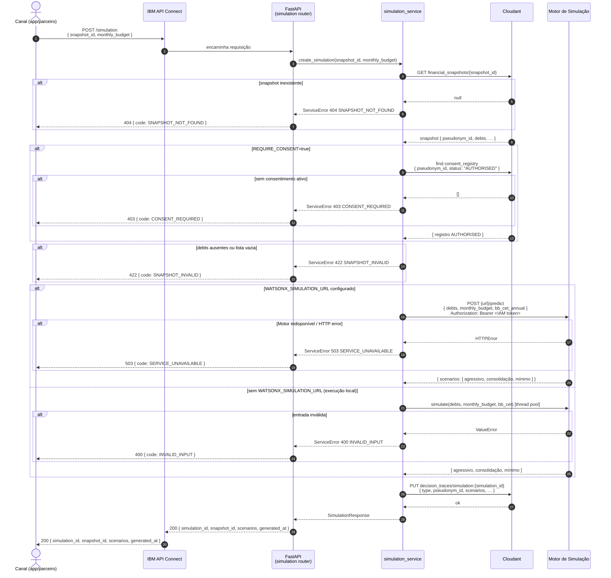
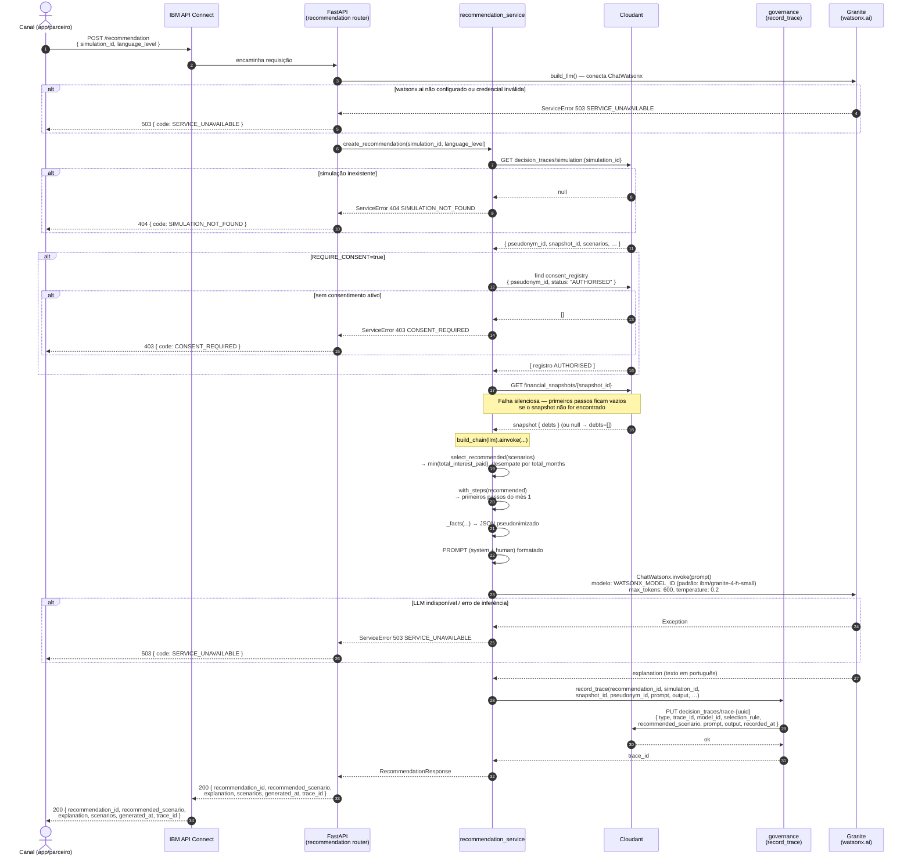

# M3 — Diagramas de Sequência

Diagramas baseados no código real de `src/api/routers/`, `src/services/`, `src/simulation/client.py` e `src/agents/recommendation_agent.py`.

---

## 1. `POST /simulation` — Simulação de cenários de quitação

---

## 2. `POST /recommendation` — Recomendação em linguagem simples

---

## Onde cada coisa roda

| Componente | Ambiente de execução |
|---|---|
| **FastAPI** (routers, services, models) | Contêiner local / IBM Code Engine |
| **Motor de Simulação** (`simulate`) — modo padrão | Thread pool local no mesmo processo (`asyncio.to_thread`) |
| **Motor de Simulação** — modo produção | AI Service externo em **watsonx.ai** (`WATSONX_SIMULATION_URL/predict`) |
| **Agente 2 / LLM** (`ChatWatsonx` + Granite) | **watsonx.ai** — sempre remoto (requer `WATSONX_URL`, `IBM_CLOUD_API_KEY` e `WATSONX_PROJECT_ID` ou `WATSONX_SPACE_ID`) |
| **Snapshots financeiros** (`financial_snapshots`) | **IBM Cloudant** — banco de snapshots do Agente 1 |
| **Simulações, recomendações e traces** (`decision_traces`) | **IBM Cloudant** — banco separado de acesso restrito |
| **Consentimentos** (`consent_registry`) | **IBM Cloudant** — lido opcionalmente quando `REQUIRE_CONSENT=true` |
| **IBM API Connect** | Gateway IBM Cloud — autenticação, rate-limit e roteamento para todos os endpoints |
